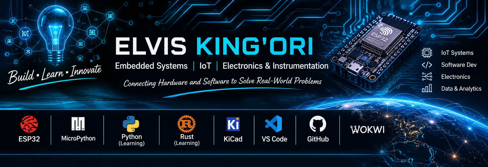

  

# Hi, I'm Elvis King'ori 👋

### Electronics | Embedded Systems | IoT | Instrumentation

I'm a Microprocessor Technology and Instrumentation student at the **University of Nairobi**, interested in building practical electronic systems that solve real-world problems.

I enjoy working with microcontrollers, sensors, displays, and embedded systems. I'm also expanding my programming skills in Python and Rust.

---

## 🛠️ Technologies & Tools

**Embedded Systems**
- ESP32 / ESP32-C3
- MicroPython
- Sensors and actuators
- UART, I²C and GPIO

**Electronics & Development**
- KiCad
- Wokwi
- Thonny
- VS Code
- Git & GitHub

**Programming**
- Python — currently learning
- Rust — currently learning

---

## 🚀 Featured Projects

### 1. ESP32-C3 Encoder OLED Project
A rotary encoder interface built using an ESP32-C3 and a display. The project explores GPIO input handling, encoder rotation, and display communication.

[View Repository](https://github.com/kings-elvis/esp32-encoder-oled)

### 2. Smart Poultry Monitoring System
An embedded monitoring project focused on observing poultry-house environmental conditions and responding to temperature and humidity changes.

[View Repository](https://github.com/kings-elvis/Smart-Poultry-Monitoring-System)  

### 3. ESP32 DC Power monitor
An ESP32-C3 Based DC Power, Voltage and Current monitoring system using Micropython, MQTT and a Streamlit dashboard.

[View Repository](https://github.com/kings-elvis/ESP32-DC-Power-monitor-)

---
---

---

## 📊 GitHub Statistics

  

  

## 📚 Currently Learning

- Improving my Python programming skills
- Learning Rust for systems and embedded development
- Developing practical embedded electronics projects
- Improving PCB design and circuit development skills

---

## 🎯 My Engineering Interests

- Internet of Things (IoT)
- Embedded systems development
- Electronics and instrumentation
- Sensor-based monitoring and automation
- Hardware-software integration

---

## 🤝 Let's Connect

I'm interested in learning, collaborating, and building practical engineering projects.

**GitHub:** [@kings-elvis](https://github.com/kings-elvis)
